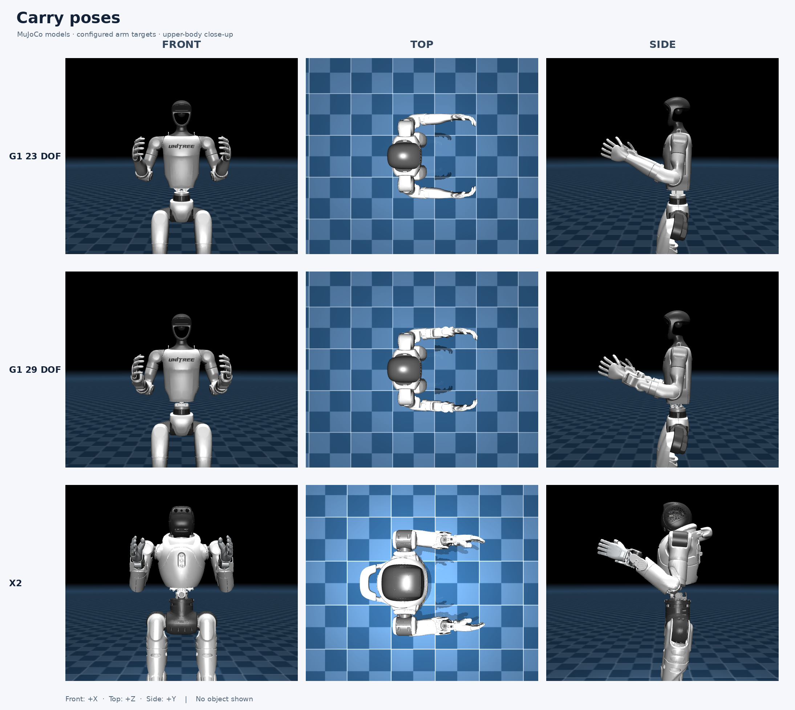

# G1 arm disturbance observer

G1 uses the [shared observer configuration and runtime](joint_observer.md).
This guide covers the stiff 23- and 29-DOF presets, simulation validation, and the
Unitree interface for 23- and 29-DOF G1 configurations.

## Stiff simulation presets

The opt-in presets use the corresponding `policy_23dof_stiff` or
`policy_29dof_stiff` checkpoint and position-controlled arms. The observer
holds each additive torque command for 20 ms. Gravity and joint coupling can
contribute to correction during unloaded motion.

```bash
python scripts/run_pipeline.py -c g1_23_locomanipulation_locomimic_observer
python scripts/run_pipeline.py -c g1_29_locomanipulation_locomimic_observer
OPENBLAS_NUM_THREADS=1 python -m scripts.evaluate_joint_observer \
  --robot g1-23 --output logs/g1_observer/stiff_validation
```

The evaluator accepts `g1-23` (the default), `g1-29`, and `x2`. Current loaded
and unloaded trials use the selected robot’s configured carry pose.

The historical 23-DOF closed-loop evaluation below used the neutral arm
target, the preset's correction limits, and a 10 N downward load per hand.
Peak hand displacement includes the instant of release and is measured
against each mode's matched unloaded trial.

| Motion | Carrying arm RMS, OFF → ACTIVE | Release hand peak, OFF → ACTIVE |
| --- | ---: | ---: |
| Standing | 0.837° → 0.00050° | 4.56 → 3.93 mm |
| Walking at 0.25 m/s | 0.865° → 0.322° | 5.93 → 6.43 mm |

SHADOW matched OFF and issued zero torque. No actuator saturation occurred.

## Additive-torque calibration

```bash
OPENBLAS_NUM_THREADS=1 python -m scripts.evaluate_joint_observer \
  --robot g1-23 --fit --output logs/g1_observer/standing_greybox_fit
OPENBLAS_NUM_THREADS=1 python -m scripts.evaluate_joint_observer \
  --robot g1-29 --fit --output logs/g1_observer/standing_greybox_fit_29
```

G1 uses the [shared torque-probe procedure](x2_upper_body_integral.md#reproduce-the-x2-coefficients).
Both robots fit coefficients from unloaded default and grasp trials and a
carry trial with a 20 N downward load per hand.
In the pelvis frame, the 23-DOF wrist-hand load points are 5 cm behind and
15 cm below the X2 hand load points. The 29-DOF wrist-yaw load points are
another 5 cm forward. Calibration and the ZMQ publisher share the targets in
`robojudo/config/g1/carry_pose.py`. Run `python scripts/test_upper_body_zmq.py --robot g1-23`
or use `--robot g1-29`, then press `7` (`custom_arms`) to select the pose.
In that module, `G1_23_CARRY_POSE` is the 23-DOF target and `G1_CARRY_POSE`
is the 29-DOF target.



The fit seeds friction at 0.10 N·m. It fixes wrist-roll inertia to the
nominal default-pose joint-space inertia, rounded to 0.01020 kg·m² for 23 DOF
and 0.01037 kg·m² for 29 DOF. The 29-DOF wrist pitch and yaw probes use a
0.125 N·m base amplitude to excite the smaller actuators above friction.
The search-bound check applies to the free parameters.

The current 23-DOF fit is stored in `robojudo/config/g1/observer_parameters_23.py`
and passed standing validation across 33 acquisitions.
At the current carry pose and 10 N per hand, the candidate's release peak was
11.92 mm standing and 12.28 mm walking; neither trial saturated. The probe
traces and carry-pose comparison are in
`logs/g1_observer/20261125_current_carry_23_fit/` and
`logs/g1_observer/20261125_current_carry_23_validation/`.
The first fit's closed-loop check used the neutral arm target. The latter
repeated the fit with an equivalent compiled rollout, produced the same
selected coefficients, and ran the carry-pose comparison.

The 29-DOF fit covers all fourteen arm joints and stores its coefficients in
`robojudo/config/g1/observer_parameters.py`. At the current carry pose and
10 N per hand, the candidate's release peak was 19.64 mm standing and 22.81 mm
walking, with no actuator saturation. The 29-DOF simulation and real observer
presets use these coefficients; the real observer defaults to OFF.
Its traces and report are in `logs/g1_observer/20261125_current_carry_29_fit/`.

## Real-robot deployment

The real observer preset uses the existing stiff G1 checkpoint and Unitree
controller settings. The three-argument native `step` takes motor-order
positions, arm-order effort, and the expected safety reset generation, as on
AimDK. The environment derives `UnitreeConfig.arm_motor_indices` from the
observer joint names and the logical-to-motor mapping. The controller uses
this order for effort limits, commands, and receipts. It accepts motor counts
up to the HG packet capacity. G1 joint layout validation lives in the Python
environment configuration.

`G1_23ObserverRealEnvCfg` maps ten arm joints into the 29-slot motor command.
`G1ObserverRealEnvCfg` supports all fourteen arm joints on the full 29-DOF G1,
including wrist pitch and yaw. The registered 29-DOF preset supplies the fitted
model.

Unitree timestamps the whole accepted LowState packet. Feedback timestamps
and position-command receipts share a native steady clock. The receipts
record host acceptance and drive the observer's command history.
[Unitree G1 SDK command writer](https://github.com/unitreerobotics/unitree_sdk2/blob/main/example/g1/low_level/g1_dual_arm_example.cpp#L1452-L1468)

Rebuild `unitree_cpp` with `python submodule_install.py unitree_cpp` before
SHADOW. The native in-process regression test is enabled by configuring the
package with `-DUNITREE_CPP_BUILD_TESTS=ON` and running CTest.

On a supported G1, enable `debug.log_obs` in the local real observer
configuration. Collect a position-only baseline with `env.observer.mode`
set to `OFF`, then set it to `SHADOW` and repeat the same standing and
walking commands.

```bash
python scripts/run_pipeline.py -c g1_23_locomanipulation_locomimic_real_observer
python scripts/run_pipeline.py -c g1_29_locomanipulation_locomimic_real_observer
```

The debug trace includes `extras.observer` and `extras.control_step_ms`. Confirm
zero arm effort in SHADOW receipts and low-command packets, validate LowState
tick progress and feedback age, and track full-loop overruns against the
20 ms period on the deployment computer.

The real preset defaults to OFF. Selecting ACTIVE uses the shared observer
actuator limits, correction fraction, and optional absolute cap. The
registered actuator bounds come from the G1 DoF configuration. Firmware
behavior and continuous hardware torque limits remain unverified.
