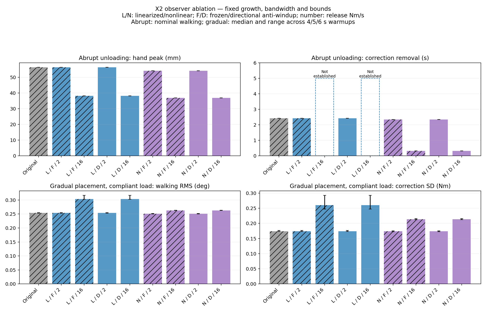

# X2 observer factorial ablation

Evaluated 2026-10-23. All **297 simulations** completed without falls. Independent
checks passed for all **297 traces**. The original and production-equivalent
nonlinear variants reproduce **42 saved reference traces exactly**, excluding
execution timing from NPZ comparisons. Acquisition source hashes remained intact.

This experiment separates estimator choice, release slew and anti-windup instead
of treating the nonlinear observer as one indivisible change. The nonlinear
configuration earns its complexity when paired with fast release in abrupt
unloading; it is not a universal improvement over the slow-release linearized
reference. Application presets were not retuned for this experiment.

## Design

Eight variants cross three factors:

| Factor | Settings |
| --- | --- |
| Disturbance estimator | Original local-gain innovation / bounded nonlinear inversion |
| Release slew | 2 / 16 Nm/s |
| Anti-windup | Freeze blocked estimate updates / permit directional unwinding |

All eight share the production nonlinear observer's zero-before-reversal output
policy. The unmodified original linearized observer is a ninth reference because
its symmetric limiter permits a small zero crossing within one update. Use the
eight factorial variants for causal comparisons; the original checks historical
reproduction. The linearized factor retains the original filtering order: raw
innovation/gain can exceed disturbance bounds, then the filtered estimate is
clamped. It does not silently add a bounded instantaneous-estimate filter.

Growth remains 2 Nm/s, bandwidth 8 rad/s, and robot gains, fitted model,
actuator bounds and correction bounds are identical. The benchmark-only
`AblationObserver` reuses production nonlinear update/limiter code, changing only
inference and blocked-estimate handling. Unit tests check production parity,
linearized filtering, factor pairing, and trace-validation rules. Runtime
wrapping and command-receipt replay are reused for abrupt unloading; transition
tests use the same synchronous-core harness as the previous comparison.

The complete matrix contains 135 jobs and 297 simulations:

- 108 local simulations: matched loaded/unloaded pairs for nominal release,
  downstream clipping and genuine reversal, with both initial load signs.
- 108 whole-robot abrupt-release simulations: standing nominal and walking
  nominal/clipped with one deterministic seed; impaired walking with three seeds.
- 81 full 105-second transition simulations: unloaded, constant load and
  compliant payload, with paired 4/5/6-second warmups.

No hardware environment or native adapter is constructed. The original safety
checks and total-torque clipping remain in the simulation harnesses.

## Abrupt unloading during nominal walking

The load is removed at 7 s while the carrying target remains fixed. The table
uses directional anti-windup for all factorial variants. Frozen variants produce
the same nominal results because their limiting path is inactive here.

| Estimator | Release (Nm/s) | Carry RMS (deg) | Hand peak (mm) | Correction removal (s) | Correction SD (Nm) |
| --- | ---: | ---: | ---: | ---: | ---: |
| Original reference | 2 | 0.2465 | 56.406 | 2.42 | 0.177 |
| Linearized | 2 | 0.2465 | 56.406 | 2.42 | 0.177 |
| Linearized | 16 | 0.3301 | 38.136 | Not established | 0.336 |
| Nonlinear | 2 | 0.2501 | 54.216 | 2.34 | 0.173 |
| Nonlinear | 16 | 0.2406 | 36.840 | 0.32 | 0.217 |

Fast release supplies most of the peak reduction. However, simply applying it to
the linearized estimator worsens carrying error and ripple, and residual
correction fails the sustained-removal criterion. Holding release at 16 Nm/s,
nonlinear estimation reduces carrying RMS from 0.3301 to 0.2406 degrees and ripple
from 0.336 to 0.217 Nm, while establishing removal in 0.32 s. This directly
supports the estimator change as part of the fast-release configuration.

The simple local nominal plant gives the same approximately 3.069-degree peak
for linearized and nonlinear fast-release variants. That local peak alone would
miss the whole-robot behavior above. Local correction removal is actually faster
with linearized estimation: 0.24 versus 0.30 s. Nonlinear inversion addresses independently
reproduced finite-residual/friction-regime errors, but this ablation evaluates
the complete bounded nonlinear estimator; it does not isolate bounding from
nonlinearity or establish a general stability theorem.

Impaired walking preserves the important distinction: fast-release linearized
estimation has 0.369–0.393-degree carrying RMS and no established correction
removal, versus 0.277–0.279 degrees and 0.32 s with nonlinear estimation. Its
39.82–44.25 mm hand peaks can be smaller than the nonlinear variant's
43.30–43.87 mm peaks in individual seeds. Peak displacement alone would conceal
the unfavorable correction tail and carrying behavior.

## Gradual placement with compliant load

These runs ramp the load down over 75–79 s. They use directional anti-windup;
ranges cover three paired warmups, not confidence intervals.

| Estimator | Release (Nm/s) | Walking RMS (deg) | Hand peak (mm) | Correction SD (Nm) |
| --- | ---: | ---: | ---: | ---: |
| Original reference | 2 | 0.253–0.255 | 0.365–0.367 | 0.174–0.177 |
| Linearized | 2 | 0.253–0.255 | 0.365–0.367 | 0.174–0.177 |
| Linearized | 16 | 0.303–0.317 | 0.369–0.370 | 0.247–0.293 |
| Nonlinear | 2 | 0.250–0.252 | 0.455–0.456 | 0.173–0.175 |
| Nonlinear | 16 | 0.263–0.264 | 0.459–0.460 | 0.212–0.215 |

This resolves the earlier attribution uncertainty. Faster release accounts for
most of the added carrying ripple and the increased nonlinear carrying RMS.
The approximately 0.09 mm gradual-placement peak difference is already present
with nonlinear estimation at 2 Nm/s; changing its release to 16 Nm/s adds only
approximately 0.004 mm. That peak tradeoff is predominantly associated with the
estimator choice in this protocol. At equal 2 Nm/s release, nonlinear estimation
slightly improves loaded walking RMS in these compliant-payload transitions.

The release limiter acts on every reduction in correction magnitude, including
normal gait fluctuations. It has no load-removal event detector. The matched
factor comparisons therefore expose a carrying-ripple cost of faster release.
Nonlinear estimation improves the fast-release carrying behavior relative to
linearized estimation, while the original slow-release configuration retains
the smaller gradual-placement hand peak.

## Restricted command authority

With downstream correction clipped to +/-1 Nm during walking:

| Estimator | Anti-windup | Release (Nm/s) | Correction removal (s) |
| --- | --- | ---: | ---: |
| Linearized | Frozen | 2 | Not established |
| Linearized | Directional | 2 | 0.56 |
| Linearized | Directional | 16 | Not established |
| Nonlinear | Frozen | 2 | Not established |
| Nonlinear | Frozen | 16 | Not established |
| Nonlinear | Directional | 2 | 0.56 |
| Nonlinear | Directional | 16 | 0.36 |

Directional unwinding fixes a distinct constrained-command recovery problem.
It cannot supply missing actuator authority: carrying RMS remains approximately
3.44–3.45 degrees and the hand peak approximately 60.6–60.8 mm in these clipped
cases. Estimation recovery and carrying-sag reduction are separate outcomes.



Dashed bars mark correction-removal criteria not established within the
five-second observation window; their plotted height is not a measured time.

## Reproduction and evidence

```bash
OPENBLAS_NUM_THREADS=1 OMP_NUM_THREADS=1 MKL_NUM_THREADS=1 NUMEXPR_NUM_THREADS=1 \
  python scripts/evaluate_x2_observer_ablation.py --jobs 4 \
  --output logs/x2_observer_ablation/20261023
python scripts/report_x2_observer_ablation.py logs/x2_observer_ablation/20261023
python -m unittest discover -s tests -p 'test_x2_observer_ablation.py'
```

Use a fresh output directory for another acquisition. The output retains source
snapshots/hashes, asset hashes, every job's result, raw NPZ/CSV traces,
`metrics.json`/CSV, `paired_effects.json`, `validation.json`, `trace_sha256.json`
and a complete per-context `findings.md`. Transition filenames retain the
harness's `nonlinear_observer` condition label; the job's variant/factor metadata
identifies the actual controller. Interpretation must use that metadata.

`verify_reference.py` and `reference_parity.json` retain the 42-trace comparison
against the earlier standing/walking release and four-method transition studies.
All 76 observer tests pass, including six ablation/analysis tests. Ruff,
formatting and whitespace checks pass. Maximum independent correction-bound
excess is zero; maximum slew excess is 8.2e-12 Nm/s (floating-point roundoff).
The largest transition saturation occupancy is 0.0571% of physics steps.

Generate the figure with `--plot` when matplotlib is available. This machine
uses its existing system plotting stack:

```bash
PYTHONPATH=/usr/lib/python3/dist-packages MPLCONFIGDIR=/tmp/x2-ablation-mpl \
  /usr/bin/python3 -S scripts/report_x2_observer_ablation.py \
  logs/x2_observer_ablation/20261023 --plot
```

An initial worker-recycling batch stalled after 12 jobs. Its source and outputs
are retained in `20261023-initial-pool-stall`. The complete batch restarted from
scratch with a persistent worker pool; it does not reuse those partial results.

Abrupt-release peaks cover the release state and remaining five-second hold,
against matched unloaded motion. Correction removal requires all correction
differences to stay below max(10% of carrying difference, 0.04 Nm), with at least
one second remaining. "Not established" means that criterion was not met within
the observation window; it is not a fall or simulation failure. Transition hand
peaks use 79–82 s; walking RMS and correction SD use 55–60 s. The worst hand and
largest per-joint correction SD are reported. Compare methods within a protocol,
since force levels, motion, windows and sampling differ between protocols.

These experiments do not sweep plant uncertainty or qualify hardware behavior or
control-loop timing. Concurrent-run execution times are diagnostic measurements.
The compliant payload is the existing translation-only model with positive
initial motion. For earlier results and full metric definitions, see
[abrupt unloading](x2_observer_release_validation.md) and
[the four-method transitions](x2_transition_methods_comparison.md).
