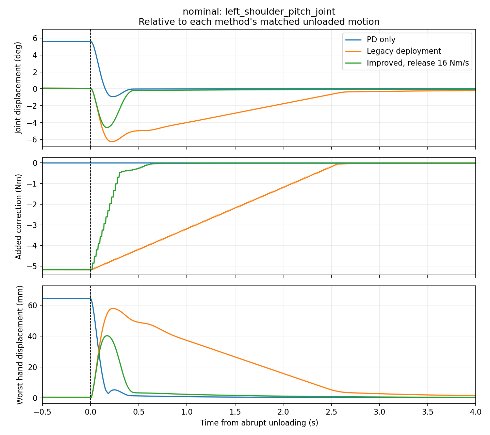
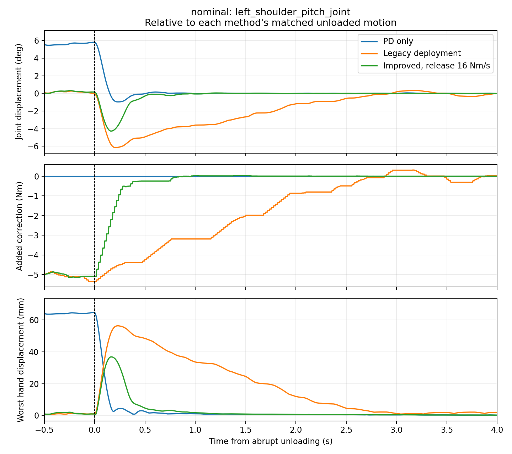

# X2 deployment observer: abrupt-unloading validation

Historical report: API names below describe commit `f0ba949`. The subsequent
[shared observer refactor](joint_observer.md) preserves these numerical results
and replaces the deployment-specific names with explicit algorithm selection.

Implemented and evaluated 2026-10-23. The deployment wrapper now uses a bounded
nonlinear disturbance estimate, directional estimate unwinding, and independent
growth/release slew rates. `x2_locomimic_real_observer` remains **OFF**; its selected
release setting is **16 Nm/s**, with growth unchanged at **2 Nm/s**. These are
simulation selections, not hardware qualification. No hardware adapter or network
controller was constructed for these experiments.

## Changes and independent findings

The original review's mechanisms were reproduced independently. A 4 Nm correction
requires at least 2 s to clear at the original rate. Removing a 4 Nm disturbance
at rest produces a 40.68 Nm local-gain inferred change and incorrectly changes
the filtered estimate from -4 to +2.015 Nm in one sample. Both limiter paths can
discard useful estimate reductions, retaining compensation after removal.

`DeploymentDisturbanceObserver` retains the existing nominal dynamics and 8 rad/s
filter, but infers an instantaneous disturbance by bounded nonlinear prediction
before filtering. It replays every acknowledged command segment over each joint's
receive interval. The search considers the previous estimate, both bounds and
20 bisection candidates. It preserves an exact previous fit and never exceeds
existing disturbance bounds. Importantly, the legacy predictor can be
discontinuous at actuator-saturation switches: when no exact root is found, the
smallest tested velocity residual is retained and exposed in diagnostics. This
is a bounded approximate inversion, not a global root/convergence guarantee.

Estimate changes that reduce existing correction are permitted under both
internal saturation and downstream limiting. Adaptation that adds correction in
the blocked direction is rejected; a crossing can unwind to zero without growing
blocked opposite torque. Prediction and slew always start from acknowledged
effort. SHADOW continues estimating while issuing zero torque.

`X2ArmObserverCfg.release_slew_nm_s` is optional and positive/finite; omission
uses the growth rate. Faster release only reduces current correction magnitude.
A reversal reaches zero on one update, then grows in the opposite direction at
the original growth rate. Actuator/correction bounds, final target clipping,
freshness, generation, eligibility and watchdog checks remain intact. Safety
removal can still clear effort immediately. The legacy simulation observer,
simulation preset and frozen coefficients are unchanged.

`get_arm_observer_status()` additionally exposes desired correction, prediction,
innovation, instantaneous inferred disturbance, inversion residual, fresh-interval
mask, release limiting, anti-windup, estimate-bound mask and separate headroom and
downstream limiting masks. These support investigating remaining carrying sag
without assuming that larger gains or torque bounds are appropriate.

## Experiment and metrics

The checked-in runner is `scripts/evaluate_x2_observer_release.py`. A fake command
adapter runs the actual deployment proposal/acknowledgement wrapper. The legacy
comparison substitutes the original observer behind the same receipt/history
boundary. PD-only issues zero correction. No observer receives load timing or
phase information.

Local trials apply -4/+2 Nm to left/right shoulder pitch from 1 to 7 s, then
remove it abruptly; separate near-bound trials use -7.5/+3.75 Nm. MuJoCo trials
hold the carrying posture with the existing locomotion policy, apply 20/10 N
downward at left/right hand centers, and remove both forces at a physics boundary
at 7 s. Walking speed is 0.3 m/s. Duration is 12 s, command period 20 ms and
MuJoCo physics period 5 ms. Each condition has its own matched unloaded trial.

The three-seed validation uses nominal feedback, an impaired case (20 ms delay,
0.02442 rad/s velocity quantization, 0.005 rad/s Gaussian noise and a 60 ms
acquisition dropout beginning at release), and a downstream ±1 Nm correction
clip. Dropout holds the complete last received sample, including its timestamp
and noise; delayed samples are never re-noised. Nominal and
clipped seeds are identical deterministic trials; stochastic seeds matter in the
impaired case. Additional local trials exercise genuine load reversal. This
study does not sweep plant uncertainty, walking speeds or all carrying poses.

Carrying RMS covers 5–7 s, all 14 arm joints, relative to the final command.
Unloading peak includes the release state and the entire remaining hold, relative
to the same method's unloaded motion. Hand peak is the worst hand's torso-frame
3D displacement. Torque-removal time requires all paired correction differences
to remain below max(10% of carrying difference, 0.04 Nm), with at least one second
observed afterward. Hand recovery similarly uses a fixed 5 mm displacement band.
`None` means the criterion was not established during the five-second recovery.

## Results and rate selection

The single-seed rate scan retained the 2 Nm/s growth rate in every improved case:

| Release rate (Nm/s) | Local 4 Nm peak (deg) | Local torque removal (s) | Standing hand peak (mm) |
| --- | ---: | ---: | ---: |
| Original observer, 2 | 4.441 | 1.82 | 57.86 |
| Improved, 2 | 4.441 | 1.82 | 57.86 |
| Improved, 8 | 3.745 | 0.46 | 48.12 |
| Improved, 16 | 3.069 | 0.30 | 40.24 |
| Improved, 20 | 2.815 | 0.30 | 37.11 |

16 Nm/s is the lowest tested rate meeting the planned nominal gates: at least
50% shorter residual-compensation duration and 20% lower unloading peak, with
carrying RMS degradation no greater than max(5%, 0.05 degrees). The 8 Nm/s
candidate reduced peak by less than 20% in both nominal plants. Gains, bandwidth
and torque limits were not increased.

Three-seed MuJoCo validation at 16 Nm/s:

| Case | Carrying RMS, old → new (deg) | Hand peak, old → new (mm) | Torque removal, old → new (s) | Hand recovery, old → new (s) |
| --- | --- | --- | --- | --- |
| Standing nominal | 0.0770 → 0.0765 | 57.86 → 40.24 | 2.34 → 0.30 | 2.52 → 0.41 |
| Walking nominal | 0.2465 → 0.2406 | 56.41 → 36.84 | 2.42 → 0.32 | 2.48 → 0.485 |
| Standing impaired | 0.0614–0.0686 → 0.0527–0.0542 | 59.03–59.10 → 46.86–47.11 | 2.28–2.40 → 0.34 | 2.53–2.545 → 0.425 |
| Walking impaired | 0.2712–0.2808 → 0.2768–0.2786 | 54.67–56.46 → 43.30–43.87 | 2.32–2.40 → 0.32 | 2.385–2.44 → 0.44–0.445 |
| Standing clipped | 3.4426 → 3.4426 | 60.30 → 60.30 | None → 0.30 | 0.335 → 0.33 |
| Walking clipped | 3.4454 → 3.4446 | 60.69 → 60.70 | None → 0.36 | 0.315 → 0.31 |

All 108 MuJoCo loaded/unloaded trials completed, without falls or actuator
saturation. All 72 local validation trials also completed. Near-bound local
peak improved from 8.90 to 7.24 degrees and torque removal from 3.38 to 0.44 s;
carrying RMS stayed 0.0596 degrees. Large reversals improved local peak from
9.53 to 7.85 degrees; opposite compensation still builds at the original rate.

Tradeoffs are measurable. Nominal walking correction ripple (largest per-joint
carrying standard deviation) increases from 0.177 to 0.217 Nm. Maximum base tilt
increases from 2.606 to 2.667 degrees. Impaired walking ripple rises by at most
0.045 Nm, tilt by at most 0.078 degrees, and paired carrying RMS by at most
0.006 degrees. These remain within the carrying-error gate; they are not claims
of identical walking behavior. Observer p99 execution time was 2.29–6.30 ms and
maximum 7.15 ms in the concurrent MuJoCo runs, versus roughly 0.2–0.4 ms p99
for the original observer. This excludes policy inference and is not a timing
guarantee on the robot computer.

The clipped case distinguishes insufficient authority from estimation recovery:
carrying sag stays large because the command is limited to 1 Nm. Faster release
cannot correct that deficit, although the estimate/issued tail now unwinds.
Nominal trials did not reach estimate bounds or command limits. Without an
ACTIVE hardware recording, the cause of remaining real carrying sag and the
relative contribution of each mechanism remain unverified. No torque bounds,
target filters or robot gains were relaxed to conceal the deficit.





## Reproduction and checks

From the repository root:

```bash
python scripts/evaluate_x2_observer_release.py --plant local --seeds 1 \
  --output logs/x2_observer_release/local-initial
python scripts/evaluate_x2_observer_release.py --plant local --rates 16 \
  --cases nominal impaired clipped reversal --seeds 1 2 3 \
  --output logs/x2_observer_release/local-validation
python scripts/evaluate_x2_observer_release.py --plant mujoco --rates 16 \
  --cases nominal impaired clipped --seeds 1 2 3 --load -20 \
  --output logs/x2_observer_release/standing-validation
python scripts/evaluate_x2_observer_release.py --plant mujoco --walking --rates 16 \
  --cases nominal impaired clipped --seeds 1 2 3 --load -20 \
  --output logs/x2_observer_release/walking-validation
python scripts/plot_x2_observer_release.py logs/x2_observer_release/standing-validation
python scripts/plot_x2_observer_release.py logs/x2_observer_release/walking-validation
python -m unittest discover -s tests -p 'test_x2_*observer*.py'
```

Plots require matplotlib; the simulation environment used here lacks that optional
package. The images were rendered with the system plotting stack, without
changing installed dependencies:

```bash
PYTHONPATH=/usr/lib/python3/dist-packages MPLCONFIGDIR=/tmp/x2-release-mpl \
  /usr/bin/python3 -S scripts/plot_x2_observer_release.py \
  logs/x2_observer_release/standing-validation
```

Results, per-physics-step NPZ traces and parameter/version metadata are retained
under the git-ignored `logs/x2_observer_release/`. Each study writes `results.json`
incrementally. Rerunning a directory replaces its outputs. The initial standing
scan used `--plant mujoco --seeds 1 --load -20`; the near-bound run used
`--plant local --rates 16 --cases nominal clipped --seeds 1 --load -7.5`.

All **58 observer tests** pass, including finite friction transitions, both
compensation signs, near-bound steady loads, bounded inversion, segmented
accepted-command replay, zero-before-reversal slew, directional unwinding,
SHADOW, generation/eligibility resets, complete-sample dropout handling and existing headless deployment safety
coverage. Ruff and whitespace checks pass. A broader 375-test run encountered
four unrelated errors: missing optional `robojudo_recorder`, and missing velocity
priorities in three pre-existing GR00T presets. Its local ZeroMQ checks required
running outside the filesystem/network sandbox; no hardware was involved.
