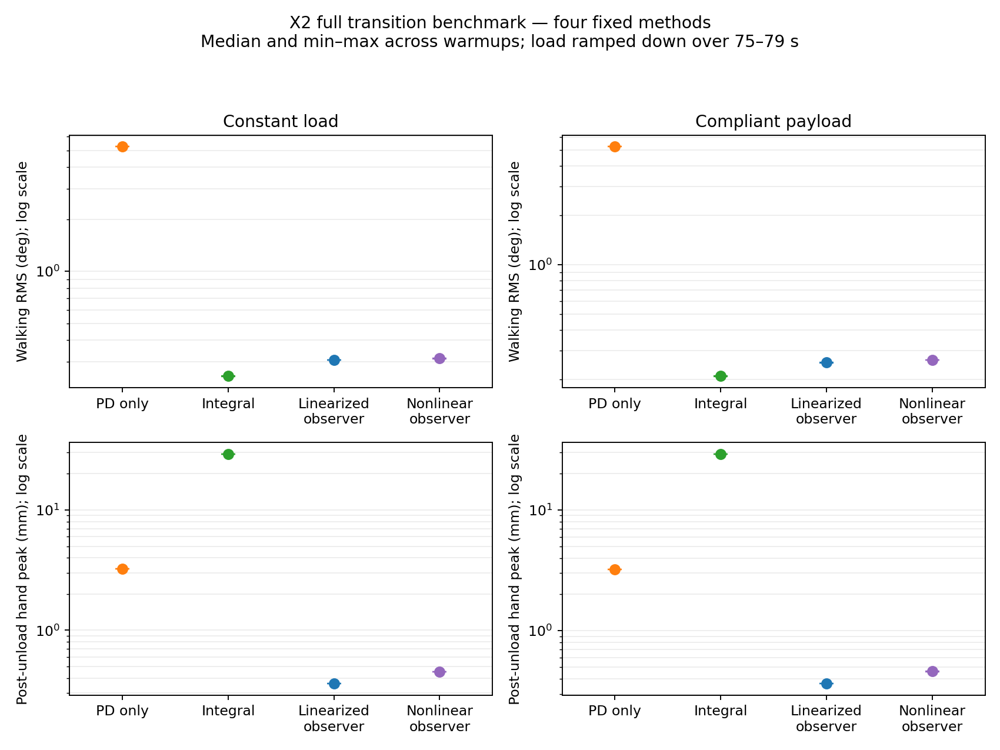

# Four-method X2 transition comparison


Evaluated 2026-10-23. All 36 simulations completed without falls. Independent
command-sample checks passed for duration, finite values, arm torque/correction
bounds, growth/release slew and zero-before-reversal behavior. Total-torque
clipping remained active at every MuJoCo physics step; saturation occupancy is
reported in the tables.

The nonlinear observer preserves strong carrying compensation and rapid recovery.
In these smooth placement transitions, its walking RMS is approximately
0.006–0.010 degrees higher and post-unload hand peak approximately 0.09 mm larger
than the linearized observer. Its correction ripple is also higher. Integral
compensation retains the lowest loaded walking error, with approximately 29 mm
post-unload motion and 5.9 s recovery to the PD envelope. The abrupt-unloading
improvements are documented separately in
[release validation](x2_observer_release_validation.md).

Completed **36/36** trials. Each scheduled trial is 105 seconds.

Methods: PD only, retained integral, frozen linearized observer, and nonlinear observer. The nonlinear observer retains 8 rad/s bandwidth and 2 Nm/s growth, with 16 Nm/s release. No robot gains, observer model coefficients, correction bounds or payload parameters were retuned.

Profiles: unloaded, prescribed constant load, and the shared compliant payload. Warmups are 4/5/6 seconds, paired across methods. There is no swaying-load trial in this run. The compliant payload uses the existing positive initial-motion direction, approximately 4.08 kg, 100/100/800 N/m stiffness, and damping ratio 0.25. Its forces depend on robot/object motion.

This benchmark exercises the synchronous correction cores under the same final-target filtering, feedback and MuJoCo total-torque clipping harness. It does not emulate native command transport.

## unloaded

| Method | Completed | Walk RMS (deg) | Peak joint error (deg) | Post-unload hand peak (mm) | Recovery to PD envelope (s) | Peak tilt (deg) | Saturated physics (%) | Correction SD (Nm) |
| --- | ---: | ---: | ---: | ---: | ---: | ---: | ---: | ---: |
| PD only | 3/3 | 1.631 | 3.915–3.934 | — | — | 2.832–2.865 | 0.000 | 0.000 |
| Integral | 3/3 | 0.271–0.277 | 2.174–2.201 | — | — | 2.828–2.853 | 0.000 | 0.003 |
| Linearized observer | 3/3 | 0.305–0.307 | 2.174–2.201 | — | — | 2.821–2.840 | 0.000 | 0.175–0.180 |
| Nonlinear observer | 3/3 | 0.291–0.298 | 2.174–2.201 | — | — | 2.821–2.857 | 0.000 | 0.228–0.231 |

## constant

| Method | Completed | Walk RMS (deg) | Peak joint error (deg) | Post-unload hand peak (mm) | Recovery to PD envelope (s) | Peak tilt (deg) | Saturated physics (%) | Correction SD (Nm) |
| --- | ---: | ---: | ---: | ---: | ---: | ---: | ---: | ---: |
| PD only | 3/3 | 5.252–5.253 | 9.443–9.604 | 3.237–3.238 | 0.020 | 2.314–2.341 | 0.000 | 0.000 |
| Integral | 3/3 | 0.248–0.249 | 3.912 | 29.147–29.160 | 5.900 | 2.687–2.801 | 0.000–0.057 | 0.004 |
| Linearized observer | 3/3 | 0.306–0.308 | 2.174–2.201 | 0.360–0.361 | 0.020 | 2.689–2.779 | 0.000–0.057 | 0.173–0.175 |
| Nonlinear observer | 3/3 | 0.313–0.314 | 2.174–2.201 | 0.453–0.454 | 0.020 | 2.686–2.779 | 0.000–0.057 | 0.217–0.222 |

## compliant_payload

| Method | Completed | Walk RMS (deg) | Peak joint error (deg) | Post-unload hand peak (mm) | Recovery to PD envelope (s) | Peak tilt (deg) | Saturated physics (%) | Correction SD (Nm) |
| --- | ---: | ---: | ---: | ---: | ---: | ---: | ---: | ---: |
| PD only | 3/3 | 5.234 | 9.500–9.579 | 3.229–3.232 | 0.020 | 2.309–2.314 | 0.000 | 0.000 |
| Integral | 3/3 | 0.210–0.211 | 3.942 | 29.020–29.034 | 5.880–5.900 | 2.681–2.905 | 0.000–0.057 | 0.003 |
| Linearized observer | 3/3 | 0.253–0.255 | 2.174–2.201 | 0.365–0.367 | 0.020 | 2.683–2.905 | 0.000–0.057 | 0.174–0.177 |
| Nonlinear observer | 3/3 | 0.263–0.264 | 2.174–2.201 | 0.459–0.460 | 0.020 | 2.679–2.884 | 0.000–0.057 | 0.212–0.215 |

## Definitions and limits

- Ranges cover the three paired warmup/seed settings; they are not confidence intervals.
- Walk RMS uses 55–60 s and all 14 arm joints against the final issued target. Peak joint error and tilt cover the entire measured trial.
- Post-unload hand peak uses 79–82 s, comparing torso-frame 3D hand positions with the same method's matched unloaded trajectory; the worse hand is reported.
- Recovery requires both hands to enter and remain in the matched PD displacement envelope over 79–89 s, with at least one second remaining. Immediate entry does not prove zero mechanical settling.
- Load is ramped down over 75–79 s, rather than removed abruptly. Physics is 5 ms, and these transition peak/recovery metrics use 20 ms control samples.
- Correction SD is the largest per-joint standard deviation over 55–60 s. Saturation is the percentage of physics steps with any actuator clipped.
- Unloaded trials have no load-induced peak/recovery comparison. Failed or unmatched trials cannot establish a recovery result.
- Compliant-payload results cover the existing translation-only model and positive initial-motion direction, not arbitrary payloads, poses, disturbances or contact mechanics.
- Simulation only; no hardware qualification is claimed.


## Plot



## Reproduction and artifacts

```bash
OPENBLAS_NUM_THREADS=1 OMP_NUM_THREADS=1 MKL_NUM_THREADS=1 NUMEXPR_NUM_THREADS=1 \
  python scripts/evaluate_x2_transitions.py \
  --condition pd_only --condition integral --condition observer --condition nonlinear_observer \
  --profile unloaded --profile constant --profile compliant_payload \
  --repetitions 3 --warmup-seconds 4 5 6 --jobs 2 \
  --output logs/x2_transitions/all-methods-compliant-20261023
python scripts/report_x2_transition_methods.py \
  logs/x2_transitions/all-methods-compliant-20261023 --plot
python scripts/plot_x2_transitions.py \
  logs/x2_transitions/all-methods-compliant-20261023
```

Use a new output directory for a rerun. Plot commands require matplotlib. This
machine rendered the plots with its system plotting stack:

```bash
PYTHONPATH=/usr/lib/python3/dist-packages MPLCONFIGDIR=/tmp/x2-transition-mpl \
  /usr/bin/python3 -S scripts/report_x2_transition_methods.py \
  logs/x2_transitions/all-methods-compliant-20261023 --plot
```

The output directory retains raw control CSVs for all 36 trials, compliant-load
physics NPZs, per-trial JSON, summary JSON/CSV, per-joint errors, detailed profile
plots, compact comparison CSV/Markdown, trace hashes and `trace_validation.json`.
No swaying-load trials were run. The compliant payload uses the existing positive
initial-motion direction; negative-direction and uncertainty sweeps remain
separate studies.

A reporting-only variable collision was found after acquisition and corrected.
All 36 simulation traces were retained unchanged, and all 18 loaded-method
comparisons were regenerated successfully. `acquisition_summary.json` and the
acquisition source snapshot preserve the original provenance; `summary.json`
also records the corrected analysis source hash. `finish_analysis.py` and
`validate_traces.py` in the output directory preserve those analysis/check steps.
All 24 loaded-method walking RMS values also agree with the existing matched
comparison calculation to within 1e-12 degrees.

Focused checks passed: 16 transition tests, 16 integral-simulation tests and
5 compliant-payload tests. Ruff and whitespace checks passed. A broader test run
still reported the previously known missing recorder dependency and three GR00T
velocity-priority errors; those errors are unrelated to these simulations.
